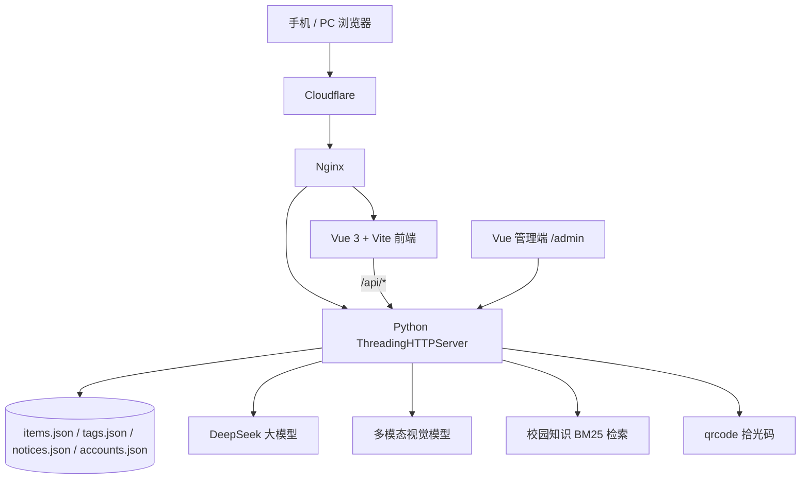

# 拾光里 · 系统架构与 AI 技术链路

## 1. 总体架构



## 2. 前端

- Vue 3.5 + Vite 6
- 组件化页面：首页、失物、招领、爱心求助、发布、雷达、侦探、拾光码、我的、通知、管理端
- `App.vue` 负责页面状态与 URL 同步
- 所有页面移动端 100vw 铺满
- 管理端独立全屏桌面布局，最大宽度 1120px

## 3. 后端

- Python 标准库 `ThreadingHTTPServer`
- JSON 文件持久化，适合比赛演示与轻量部署
- 主要 API：
  - `/api/items` 发布 / 列表
  - `/api/items/<id>/claims` 认领
  - `/api/claims/<id>` 审核 / 完成
  - `/api/agent/radar` 雷达
  - `/api/agent/detective` 侦探
  - `/api/ask` 校园问答
  - `/api/tags` 拾光码
  - `/api/tags/<code>/notify` 扫码通知
  - `/api/admin/*` 管理端

## 4. AI 审核链路

```text
用户输入
  → 规则预审（手机号、重复字符、范围词）
  → 多模态图片描述（可选）
  → DeepSeek 语义审核
  → 二元终审（review 时再判一次）
  → 分数归一化
  → 自动通过 / 自动驳回
```

- 审核结果写入 `item.ai`：decision、score、reason、source、model
- AI 不可用时使用规则引擎，仍保持全自动
- 所有用户文字输入：发布、认领、补充、拾光码、扫码留言、公告

## 5. 雷达 Agent

```text
scan_items（扫描公开信息）
  → match（地点/时间/文本比对）
  → hotspot（高频区域）
  → 返回匹配理由与置信度
```

前端 `Agent Trace` 面板展示工具名、发现、技术标签。

## 6. 侦探 Agent

```text
路线解析
  → 校园地点知识 RAG
  → 候选点排序
  → 行动建议生成
```

## 7. 拾光码

```text
生成码 → https://shiguangli.work/?tag=CODE
扫码 → 读取 /api/tags/CODE
留言 → AI 审核 → 站内通知失主
     → 自动生成一条扫码招领
失主认领 → 发布者通过 → 取件码 → 确认归还
```

二维码只编码域名 + code，不含版本号；版本更新不影响旧码。

## 8. 数据与隐私

- 手机号公开页打码
- 认领通过后才交换完整联系方式
- API Key 只放 `.env`，不进 Git
- 拾光码注销后不再返回手机号
- `tags.json` / `items.json` 部署前自动备份

## 9. 已知边界

- JSON 文件存储，不是生产级数据库
- 站内通知，不是短信 / 微信推送
- RAG 是 BM25 + 规则，不是向量库
- 视频、PDF 文档、真实用户评测仍需补齐
